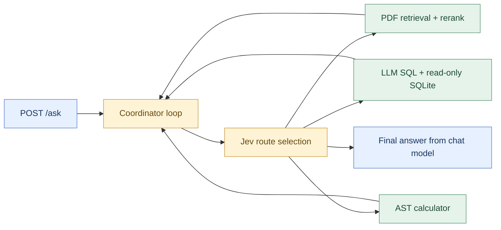

<div align="center">

# 🏦 Adan Banking Assistant

**Ask questions. Retrieve evidence. Calculate answers.**

A Persian-first banking demo with traceable routing and source-backed answers.

`FastAPI` · `Jev` · `LangGraph` · `Milvus` · `SQLite` · `LangSmith`

[Quick start](#quick-start) · [Architecture](#architecture) · [Documents](#documents-and-storage) · [Tests](#tests) · [Observability](#logs-and-langsmith)

</div>

> **Demo data only.** All customers and banking rules are fictional. Amounts are in Iranian rials (**IRR**).

| 💬 Chat | 📚 Documents | 🧮 Tools | 🔎 Visibility |
| --- | --- | --- | --- |
| Persian UI, Markdown & LaTeX | Persian/English PDF + OCR | Read-only SQL & calculator | Routes, sources & timings |

---

## Quick start

Requires Docker and Docker Compose. Create `.env` only if it does not already exist:

```bash
git clone https://github.com/lhoorie/bank-ai-assistant.git
cd bank-ai-assistant
if [ ! -f .env ]; then
  cp .env.example .env
fi
# Configure your provider and models in .env.
docker compose up -d --build
docker compose ps
```

The provider must support `/chat/completions` with tools, `/embeddings`, and `/rerank`. For OpenRouter, use `MODEL_BASE_URL=https://openrouter.ai/api/v1`. Jev uses `ROUTER_BASE_URL=https://openrouter.ai/api/alpha` and the same `MODEL_API_KEY`. See `.env.example` for settings; never commit `.env`.

### Open the app

| Destination | Link |
| :--- | :--- |
| **Chat** | [localhost:8000](http://localhost:8000/) |
| **Database & chunks** | [Data explorer](http://localhost:8000/explorer) |
| **API playground** | [Swagger UI](http://localhost:8000/docs) |
| **Liveness** | [Health check](http://localhost:8000/health) |

### Try a question

```bash
curl -sS http://localhost:8000/ask \
  -H 'Content-Type: application/json' \
  -d '{"question":"Compare Sara’s balance with the minimum opening balance in accounts.pdf. Use the calculator to compute the ratio."}'
```

Responses include `answer`, `request_id`, tool `trace`, `router_trace`, and `timings`. When tracing is enabled, they also include `langsmith_trace_id`. `/health` checks API liveness only.

<details>
<summary><strong>Updating and restarting containers</strong></summary>

Use `docker compose up -d` when code is unchanged. Rebuild after code or dependency changes. To apply only environment changes to an up-to-date image:

```bash
docker compose up -d --force-recreate assistant
```

`restart` does not reload Compose environment variables. Files copied with `docker compose cp` are temporary container changes: rebuild from the current source before recreating that container.

</details>

---

## Architecture



- **Routing:** Jev selects documents, database, both, calculator, or final. The coordinator allows up to six rounds and four tool calls per round. Clear `ROUTER_MODEL` to use chat-based routing instead.
- **Documents:** PyMuPDF extracts text, with in-memory Persian/English OCR when needed. Text is normalized and split into 180-word chunks with 30-word overlap. Embeddings are cached and searched in Milvus using COSINE similarity, then remotely reranked. The document tool returns evidence and citations; the coordinator generates the final answer once.
- **SQL:** The chat model generates queries. SQLGlot and SQLite authorization restrict execution to a single read-only SELECT on the three demo tables. Results are limited to 200 rows, with a two-second SQLite VM execution deadline.
- **Calculator:** A custom AST evaluator accepts numbers, parentheses, and `+ - * /`; it does not use `eval`.
- **Parallelism:** Exactly one database call and one document call in the same round can run concurrently. Calculator calls remain sequential. Selecting `both` makes both tools available; it does not guarantee both are called in that round.

The UI supports Markdown, LaTeX, and the locally bundled Vazirmatn font. Displayed conversation history is bounded and is not sent to the model; each question is independent. The explorer is read-only and does not call a model. Timing spans overlap and nest, so their durations should not be summed.

## Documents and storage

PDFs live in `data/bank_documents`; SQLite lives in `data/bank.db`. The seed creates English account/card policies and sample customer data. A four-page Persian PDF covers the separate **Sepehr demo** product. Specify the filename or product when rules differ.

### Sample database and data generation

[`data/bank.db`](data/bank.db) is a bundled SQLite database containing fictional demo data: 3 customers, 3 accounts, and 7 transactions. No real customer data is included.

To create the database when missing or add any missing seed records, run from the project root:

```bash
python -m pip install -r requirements.txt
python -m app.seed
```

With Docker, seeding runs automatically during image build and application startup. To run it manually in the running container:

```bash
docker compose exec assistant python -m app.seed
```

The seed also creates `accounts.pdf` and `cards.pdf` if they are missing. It uses `INSERT OR IGNORE`: existing rows are preserved, so this command does not reset modified data. The bundled database is a reproducible starting snapshot; keep runtime database changes out of commits. The Persian sample document is included in `data/bank_documents/persian_demo_rules.pdf`; its generator is `scripts/create_persian_pdf.py`.

Check extracted text before indexing, without model calls or output files:

```bash
docker compose exec assistant python -m scripts.check_pdf \
  /app/data/bank_documents/persian_demo_rules.pdf
```

For a new PDF, save it in the project folder and copy it into the running container:

```bash
docker compose cp data/bank_documents/FILE.pdf assistant:/app/data/bank_documents/
```

The next document question rebuilds the index when the document fingerprint changes. The fingerprint also includes embedding configuration and extraction settings/version. Older Milvus collections are retained; the explorer lists them too. Explicit PDF names constrain the Milvus search before top-k selection and reranking. Standalone numeric lines are retained so amounts are not discarded. Preprocessing changes also invalidate the embedding cache.

| PDF size | Pages per PDF | OCR pages | OCR resolution |
| :---: | :---: | :---: | :---: |
| **20 MB** | **100** | **20** | **200 DPI** |

OCR images stay in memory. For a broken text layer:

```bash
docker compose exec -e PDF_FORCE_OCR=true assistant \
  python -m scripts.check_pdf /app/data/bank_documents/FILE.pdf
```

Milvus data persists in the named `milvus_data` volume. SQLite, PDFs, and the embedding cache are **not host-mounted** in the current Compose configuration; container-only changes can be lost on recreation. Keep source documents in the project too. `docker compose down` keeps volumes; `down -v` deletes them.

## Tests

Run against an image containing the latest source and tests:

```bash
docker compose exec assistant python -m pytest -q
docker compose exec assistant python -m scripts.verify_tools
# Optional integration test against real Milvus:
docker compose exec -e TEST_MILVUS=1 assistant python -m pytest -q tests/test_vector_store.py
# UI rendering checks; requires an existing Node installation:
node tests/check_render.cjs
```

**Latest verification:** 100 tests passed, including real Milvus filtering/reconnection; UI rendering checks passed.

Tests are in [`tests/`](tests/). Coverage includes SQL safety, arithmetic, PDF/OCR, retrieval, routing, parallel execution, the explorer, logging, and local LangSmith instrumentation. Unit tests use controlled model/reranker responses; they do not guarantee real-model answer quality.

[`examples/scenarios.json`](examples/scenarios.json) contains 22 scenarios covering English/Persian documents, joins, balances, arithmetic, mixed sources, missing data, and rejected operations. Questions name the relevant PDF where product rules differ.

```bash
# List examples without API calls:
python -m scripts.run_scenarios --list
# Capture a small provider-backed sample (API must be running):
python -m scripts.run_scenarios --ids account-opening monthly-expenses balance-ratio
# Run all scenarios:
python -m scripts.run_scenarios
```

The runner overwrites `examples/actual-results.json`, checkpoints each result, and records HTTP status and elapsed time. Review expected versus actual manually: HTTP 200 alone does not establish correctness. These commands make real provider calls except `--list`. See [recorded evaluation](examples/README.md) for actual outputs and the observed incomplete Persian answer. `examples/tool-results.json` contains deterministic local tool results, not LLM answers.

## Limitations

This demo has no authentication and uses sample customer data. Model-generated SQL and answers still require evaluation; OCR quality depends on the PDF. Each question is independent, and old Milvus collections need explicit cleanup. The current Compose setup persists Milvus only; keep PDFs and seed data in the project before recreating containers.

## Logs and LangSmith

```bash
docker compose logs -f --tail=100 assistant
```

`LOG_LEVEL=INFO` logs request IDs, request duration/status, routes, tool outcomes, and errors. `DEBUG` adds stage timings. Application logs omit questions, answers, SQL text, customer rows, credentials, and provider error bodies. The response ID matches `X-Request-ID` and is propagated to parallel tools.

Compose caps Docker logs at three 5 MB files per container. These settings apply on container recreation, not restart, and do not limit volumes or Milvus internal files. Builds and old vector collections can still consume disk; inspect with `docker system df` and `df -h /`.

<details>
<summary><strong>Enable optional LangSmith tracing</strong></summary>

Add to `.env`:

```env
LANGSMITH_TRACING=true
LANGSMITH_API_KEY=YOUR_LANGSMITH_KEY
LANGSMITH_PROJECT=adan-banking
LANGSMITH_ENDPOINT=https://api.smith.langchain.com
```

LangSmith is disabled by default and requires its own key. After applying the environment settings, ask a question and open the configured project in LangSmith; root traces are named `banking_assistant`. Enabled tracing sends questions, answers, SQL, and evidence to your account. Credentials and embedding vectors are removed; customer data is not anonymized. Set `LANGSMITH_HIDE_INPUTS=true` and `LANGSMITH_HIDE_OUTPUTS=true` to hide inputs and outputs entirely. Tests use local tracing without contacting a real account.

</details>
